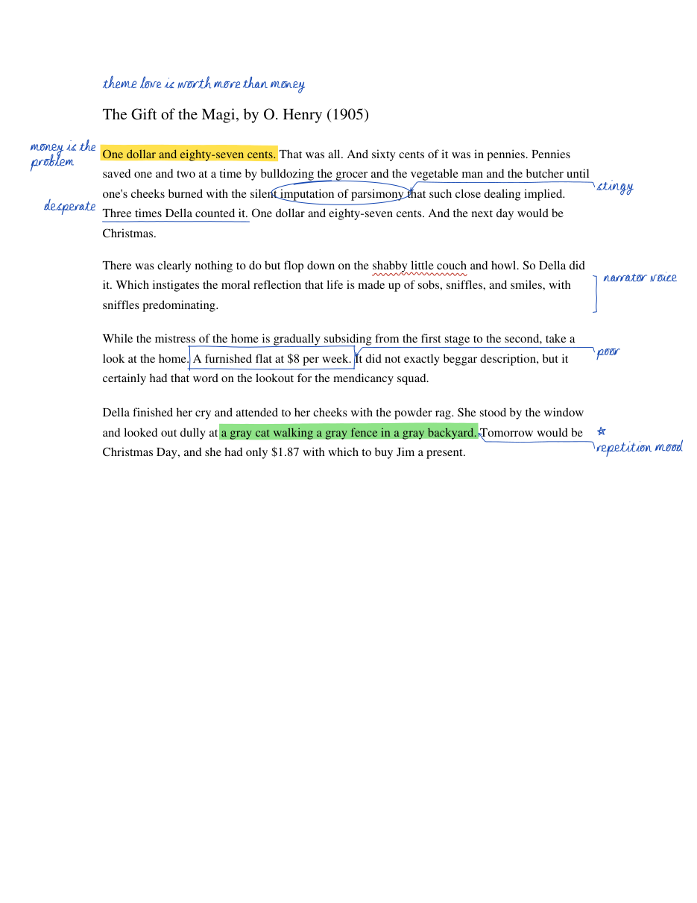

# Annotating Engine

Annotates a PDF the way you would with a pen: highlights, underlines, circles, boxes, brackets, stars and checks
that look hand-drawn, and margin notes in **your own handwriting**, written by the
[Handwriting Engine](https://github.com/nikigogonis2009/Handwriting-Engine).

You say *what* to mark by quoting the text. The engine finds it on the page (ignoring case, punctuation, line breaks
and hyphenation), draws the mark, finds free space in the margin for the note, and joins the note to its text with
a line when they are not side by side.



*`examples/example-plan.json`, with notes written by the Handwriting Engine (here from the fake test handwriting in `tests/`).*

## Quick start

    pip install pymupdf
    git clone --depth 1 https://github.com/nikigogonis2009/Handwriting-Engine hw-engine

    # what is on the page, and how much room the margins have
    python3 tools/annotate.py inspect reading.pdf --text

    # a fast preview with a plain font (no handwriting needed)
    python3 tools/annotate.py apply plan.json --font --png 110

    # the real thing, in your handwriting
    python3 tools/annotate.py apply plan.json --engine hw-engine --samples my-handwriting.json --png 110

A locked `handwriting.enc.json` works for `--samples` too, with the password in `HANDWRITING_PASSWORD`
(never as an argument).

## The plan

```json
{
  "pdf": "reading.pdf",
  "out": "reading-annotated.pdf",
  "ink": "#1749b3",
  "note_xh_pt": 5.5,
  "annotations": [
    { "page": 1, "at": "top", "note": "theme: love is worth more than money" },
    { "quote": "One dollar and eighty-seven cents", "mark": "highlight", "note": "money is the problem" },
    { "quote": "imputation of parsimony", "mark": "circle", "note": "stingy?" },
    { "quote": "life is made up of sobs, sniffles, and smiles", "mark": "bracket", "note": "narrator voice" },
    { "quote": "a gray cat walking a gray fence", "mark": "highlight", "color": "green", "note": "repetition = mood" },
    { "quote": "Tomorrow would be Christmas Day", "mark": "star" }
  ]
}
```

Paths are relative to the plan file. See `examples/example-plan.json`.

**Per annotation**

| Field | Meaning |
| --- | --- |
| `quote` | The text to mark, as it reads. Spans lines and pages' hyphenation fine. |
| `page` | 1-based. Limits the search to that page (needed for a note with no quote). |
| `occurrence` | Which match, when the quote appears more than once (default 1). |
| `mark` | `highlight` (default with a quote), `underline`, `squiggle`, `strike`, `circle`, `box`, `bracket`, `double-bracket`, `star`, `check`, `none`. |
| `color` | `#rrggbb` or a highlighter name: `yellow`, `green`, `blue`, `pink`, `orange`, `purple`. |
| `note` | Margin note text (keep it short: margins are narrow). |
| `kind` | `"math"` for TeX-style notes (`x^2`, `\frac{a}{b}`), as in the Handwriting Engine. |
| `side` | `left`, `right` or `auto` (default: the margin nearer the quote, right if in doubt). |
| `arrow` | `true`/`false` to force the leader line on or off (default: drawn when the note is not right beside its text). |
| `at` | `"top"` or `"bottom"` for a page note above or below the text (summary, theme). |
| `x`, `y`, `width` | Put a note exactly here (points from the top-left), instead. |
| `seed`, `neatness`, `note_xh_pt` | Another take of the handwriting; legibility 0..1 (default 0.6); letter size. |

**For the whole plan:** `ink`, `highlighter` (default colour), `note_xh_pt` (lowercase letter height in points, default
5.5), `pen_pt`, `seed`, `extend_margin` (points of blank space added to the right of every page, or
`{"left": 60, "right": 150}`, for when the margins are too narrow to write in), `highlight_under_text` (default true:
highlighter goes under the words like real ink; on scanned pages it is see-through on top instead).

**What it reports:** quotes it could not find, notes that had to move down or did not fit, and characters that have
no handwriting sample. The exit code is 1 if any annotation was left out.

## Limits

- The PDF needs a text layer to find quotes. A scan without one has to be OCR'd first (e.g. `ocrmypdf`).
- Rotated pages are not handled.
- Notes are written at the width of the margin. Long notes on narrow margins wrap into tall columns; use
  `extend_margin` or a top/bottom page note.
- The handwriting is only as good as the samples behind it (see the Handwriting Engine's notes on digits).

## Tests

    python3 -m unittest discover tests
    HANDWRITING_ENGINE=hw-engine python3 -m unittest discover tests   # also the handwriting path, with fake handwriting
